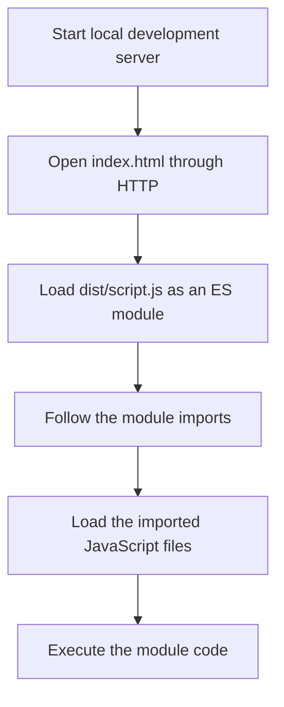
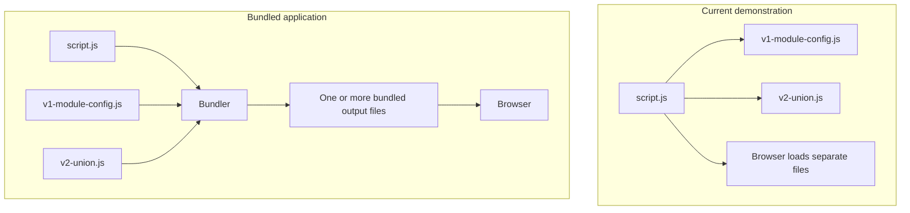

# 2-1: Setting up TS modules

## Table of Contents

1. [Why We Are Moving to Multiple Files](#1-why-we-are-moving-to-multiple-files)
2. [Reinitializing the Project Structure](#2-reinitializing-the-project-structure)
3. [Configuring the TypeScript Compiler](#3-configuring-the-typescript-compiler)
4. [Compiling TypeScript and Opening the HTML Page](#4-compiling-typescript-and-opening-the-html-page)
5. [Moving Code into a Separate TypeScript File](#5-moving-code-into-a-separate-typescript-file)
6. [Understanding the Module Dependency](#6-understanding-the-module-dependency)
7. [Exporting and Importing a Function](#7-exporting-and-importing-a-function)
8. [Why the Import Path Uses `.js`](#8-why-the-import-path-uses-js)
9. [Using ES Modules in the Browser](#9-using-es-modules-in-the-browser)
10. [Running the Project Through a Local Server](#10-running-the-project-through-a-local-server)
11. [Importing a Whole File for Its Side Effects](#11-importing-a-whole-file-for-its-side-effects)
12. [Understanding the Name Collision](#12-understanding-the-name-collision)
13. [Using `moduleDetection: "force"`](#13-using-moduledetection-force)
14. [Individual Modules and Bundling](#14-individual-modules-and-bundling)
15. [The Root-Level `v1-module-config.js` File](#15-the-root-level-v1-module-configjs-file)
16. [Summary](#16-summary)

---

## 1. Why We Are Moving to Multiple Files

In the previous module, the instructor explored TypeScript concepts by writing the code in one file. This was intentional. At that stage, TypeScript was new, so keeping everything in a single file reduced the amount of project setup and extra concepts that learners had to deal with. The main goal was to make the first steps easier to follow instead of making the learning process feel overwhelming.

Now that the basic introduction to TypeScript has been completed, the project is moving to a multiple-file structure. The code in the upcoming lessons will become larger. Keeping every function and example in one file would make it harder to understand and manage. Separating related code into different files will make the project easier to follow.

The instructor also explains that many frontend tools handle module configuration automatically. For example, when a frontend project is initialized with Vite, much of this setup is already provided. A developer may not need to configure every detail manually. However, understanding the underlying configuration is still useful. It helps developers understand what the tools are doing and makes it easier to handle similar ideas in backend projects, where some details may be different.

The purpose of this lecture is therefore to configure a small TypeScript project for multiple files and understand how those files are connected and executed by the browser.

## 2. Reinitializing the Project Structure

The instructor briefly rebuilds the project structure so the individual parts are easy to see. The project needs a `dist` folder for compiled JavaScript output, a `src` folder for TypeScript source files, and an `index.html` file for the browser page. The main TypeScript entry file is placed inside `src` and is named `script.ts`.

The resulting source structure shown in the provided project is:

```text
.
├── index.html
├── src/
│   ├── script.ts
│   ├── v1-module-config.ts
│   └── v2-union.ts
├── tsconfig.json
└── v1-module-config.js
```

The `src` folder contains the TypeScript files that the developer writes. The `dist` folder is configured as the destination for the JavaScript files created by the TypeScript compiler. The supplied final project listing does not show `dist` as a checked-in source folder, but the HTML file points to a compiled file inside it. The compiler creates the output directory when it emits the JavaScript files.

The `index.html` file provides the page that will be opened in the browser. The `script.ts` file acts as the main TypeScript entry point. The other TypeScript files hold separate pieces of code that `script.ts` will load. The `tsconfig.json` file tells the TypeScript compiler how to process the project.

## 3. Configuring the TypeScript Compiler

The instructor recaps the TypeScript compiler setup. The `tsc --init` command creates a `tsconfig.json` file. This configuration file tells the TypeScript compiler which source directory to use, where to place the compiled output, and which JavaScript module and language settings to follow.

The final `tsconfig.json` from the supplied code is:

```json
{
  "compilerOptions": {
    "rootDir": "./src",
    "outDir": "./dist",
    "module": "esnext",
    "target": "esnext",
    "strict": true,
    "skipLibCheck": true,
    "moduleDetection": "force"
  }
}
```

The important settings are explained below.

### `rootDir`

`"rootDir": "./src"` tells TypeScript that the source files for this project are inside the `src` directory. This keeps the TypeScript source code in one place and establishes the source root for the project.

### `outDir`

`"outDir": "./dist"` tells TypeScript to place the compiled JavaScript output inside the `dist` directory. The developer writes TypeScript files in `src`, and the browser uses the JavaScript files produced in `dist`.

### `module`

`"module": "esnext"` configures the compiler to use the modern ECMAScript module format. This is important in this lecture because the project is using `import` statements to connect separate files.

### `target`

`"target": "esnext"` sets the JavaScript language target to the modern ECMAScript version selected by the configuration. The instructor removes settings that are not needed for this small demonstration and uses the ESNext settings for the module example.

### `strict`

`"strict": true` enables TypeScript's strict checking options. This setting is kept in the final configuration shown in the supplied code.

**Additional note (not from the lecture):** Strict checking helps TypeScript report more potential type-related problems while the code is being written.

### `skipLibCheck`

`"skipLibCheck": true` is also kept in the final configuration. The lecture includes this setting in the final configuration but does not spend time discussing its behavior.

**Additional note (not from the lecture):** This option tells TypeScript to skip type-checking declaration files (`.d.ts` files) for libraries. It can reduce checking work, but it does not mean that TypeScript skips checking the project's own source files.

### `moduleDetection`

`"moduleDetection": "force"` is the setting added near the end of the lecture. It tells TypeScript to treat every source file as a module. This prevents variables declared in separate files from being placed into one shared global namespace. The reason for adding this setting is explained later, after the instructor demonstrates a name collision.

At the beginning of the configuration recap, the instructor removes options that are not needed for this example and keeps the source directory, output directory, and ESNext module setup. The `moduleDetection` option is added later after its purpose becomes clear.

## 4. Compiling TypeScript and Opening the HTML Page

A browser does not run the TypeScript source file directly in this project. The TypeScript compiler first converts the `.ts` source files into JavaScript files. The instructor uses `tsc` to compile the project. The `tsc --watch` command can then keep the compiler running and recompile the files when they change.

The basic workflow is:

```bash
tsc --init
tsc
tsc --watch
```

The first command initializes the TypeScript configuration. The second performs a compilation. The third starts watch mode so that later changes are compiled automatically. In practice, the initial compilation and watch process are separate ways of running the compiler; the instructor switches to watch mode during the demonstration.

The HTML file contains a heading and points to the compiled JavaScript entry file. Its final contents are:

```html
<!DOCTYPE html>
<html lang="en">
<head>
  <meta charset="UTF-8">
  <meta name="viewport" content="width=device-width, initial-scale=1.0">
  <title>Document</title>
</head>
<body>
  <h1>Hello World</h1>
</body>
<script type="module" src="./dist/script.js"></script>
</html>
```

The `<h1>` element displays `Hello World` on the page. The script element loads `./dist/script.js`, which is the JavaScript file compiled from `src/script.ts`. The `type="module"` attribute is part of the final setup and is important when the browser needs to process ES module imports.

At first, before the module-import problem is introduced, the instructor opens the HTML file directly from the project folder and checks that the `Hello World` heading appears. This confirms that the basic HTML page is working. Later, when the project starts loading imported modules, opening the file directly will cause a browser security problem, so the project will need to be served through a local server.

## 5. Moving Code into a Separate TypeScript File

After the initial page works, the instructor demonstrates why the project needs separate files. Instead of keeping all the code in `script.ts`, a new file named `v1-module-config.ts` is created inside the `src` directory. The greeting function is placed in that file.

The final version of `src/v1-module-config.ts` is:

```typescript
// export {}

const greetings = () =>{
  console.log("Siam AHMED")
}
greetings()
```

The `greetings` constant stores an arrow function. When the function is called, it writes `Siam AHMED` to the browser console. The final line, `greetings()`, calls the function when this file is executed.

The first line, `// export {}`, is a comment. It does not run and does not export anything in the final code. The instructor later discusses an empty export as a way to make a file a module, but the final configuration uses `moduleDetection: "force"` instead.

The next file, `src/v2-union.ts`, contains another greeting function:

```typescript
const greetings = () =>{
  console.log("fahim AHMED")
}
greetings()
```

This file also defines a function named `greetings`, but its function prints `fahim AHMED`. The two files are used to demonstrate that separate TypeScript files need to be treated as separate modules; otherwise, declarations with the same name can collide.

## 6. Understanding the Module Dependency

Creating a separate file does not automatically mean that the browser will load it. The browser starts from the JavaScript file referenced by the HTML page. It then follows the imports declared by that file and loads the files connected to it.

This relationship is called a dependency relationship. In this lecture, the browser begins with `script.js`. If `script.js` imports `v1-module-config.js`, the browser knows that the first file depends on the second one and loads it as part of the module graph. If there is no import or other connection from `script.js` to `v1-module-config.js`, the browser has no reason to load that separate file.

The instructor demonstrates this by placing the greeting function in `v1-module-config.ts` and then removing the previous greeting code from `script.ts`. When the page is reloaded, the heading remains, but the greeting function does not run. The reason is not that the function is broken. The reason is that the browser has not been told that the main script depends on the new file.

The relationship can be represented like this:

```mermaid
flowchart TD
    A[index.html] --> B[dist/script.js]
    B -->|import statement| C[dist/v1-module-config.js]
    C --> D[Run greetings()]
```

The diagram shows the dependency chain. The HTML page loads the main script, and the main script must import the other module for the browser to load and execute it.

The key lesson is that a file needs to be connected to the application's entry point. Simply creating a TypeScript file in `src` is not enough to make its code run in the browser.

## 7. Exporting and Importing a Function

The first way the instructor demonstrates connecting the files is to export the `greetings` function from `v1-module-config.ts` and import it into `script.ts`. An exported value can be made available to another module through an import statement. This creates the dependency between the two files.

The supplied final `src/script.ts` preserves the earlier named-import attempt as commented code:

```typescript
// import { greetings } from "./v1-module-config.js";

// greetings

import "./v1-module-config.js"
import "./v2-union.js"
```

The commented lines show the named-import approach that was demonstrated earlier. In that approach, the source module exports a particular value, and the importing file requests that value by name. The final active code uses a different approach, which is explained in the section about importing a whole file.

The important point in this part of the lecture is that importing a function creates a dependency. Once the main script imports something from `v1-module-config`, the browser knows that the module is connected to the main script and can load it.

## 8. Why the Import Path Uses `.js`

A question that may come up is why the import statement inside a TypeScript file uses a `.js` extension instead of `.ts`. The instructor explains that the browser ultimately needs JavaScript. TypeScript source files are compiled into JavaScript, and the browser does not execute the `.ts` source file in this setup.

For that reason, the import path is written with `.js`, even though the developer is currently editing a `.ts` file. TypeScript understands the relationship while compiling, and it preserves the `.js` extension in the emitted JavaScript. When the browser follows the import, it requests the JavaScript file that the compiler produced.

The final imports in `src/script.ts` therefore use these paths:

```typescript
import "./v1-module-config.js"
import "./v2-union.js"
```

The `.js` extension is intentional. It describes the file that the browser will load at runtime, not the TypeScript source file that the developer edits. The instructor warns that if the editor's auto-import feature inserts a `.ts` extension or omits the `.js` extension in this setup, the import should be corrected to use `.js`.

## 9. Using ES Modules in the Browser

After the dependency is created, the instructor reloads the page and encounters an error saying that import declarations may only appear at the top level of a module. The reason is that the browser is still treating the script as a traditional script rather than an ES module.

The browser needs to know that the script should be handled as a module. This is done in `index.html` by adding `type="module"` to the script element:

```html
<script type="module" src="./dist/script.js"></script>
```

The final `index.html` already contains this attribute. It tells the browser to process the loaded JavaScript file using the ES module system. This allows the browser to understand the module's top-level `import` statements and follow its dependencies.

The sequence is important: first, the main file imports another file; then, the HTML script element is marked as a module so the browser can process that import syntax.

## 10. Running the Project Through a Local Server

After adding `type="module"`, the instructor reloads the page and encounters another browser error related to cross-origin requests. The page is being opened directly from the local file system, using a `file://` location, rather than being served from an HTTP server. In this situation, the browser blocks the module file request.

The instructor's solution is to serve the HTML page through a local development server. The lecture mentions two options: VS Code's Live Server and the `serve` command-line tool. Either option provides an HTTP address for the browser instead of opening the HTML file directly from the file system.

The instructor mentions that Live Server commonly uses port `80`, while the `serve` option may use port `3000` in the demonstration. The exact address shown by a local server is the address that should be opened in the browser.

The browser loading process now looks like this:



Once the page is served through the local server, the browser can load the module files and the greeting output appears in the console. This completes the connection between the HTML page, the compiled entry script, and the imported module.

## 11. Importing a Whole File for Its Side Effects

After the first import works, the instructor raises a practical question: does every function or console operation in a separate file need to be exported and then individually imported into `script.ts`? For this small learning project, the instructor shows a simpler approach.

Instead of importing a specific function by name, the main script can import the whole file:

```typescript
import "./v1-module-config.js"
```

This is commonly called a side-effect import. The import does not request a named function or variable. Its purpose is to load the module and execute its top-level code. In `v1-module-config.ts`, the `greetings()` call is at the top level, outside the function body. Therefore, loading the module causes that call to run.

The instructor applies the same approach to the second file. The final `src/script.ts` is:

```typescript
// import { greetings } from "./v1-module-config.js";

// greetings

import "./v1-module-config.js"
import "./v2-union.js"
```

Now `script.ts` imports both files directly. The first imported file runs its greeting function, and the second imported file runs its own greeting function. The functions do not need to be exported for this particular side-effect-import approach because the main script is not trying to access the functions themselves; it only needs the modules to execute.

The instructor describes this as a learning-purpose approach. In larger applications, loading and executing every file immediately is not always desirable. A real application may only need certain parts at a particular time. The dependency system helps organize what is loaded, and the application can be structured so that only the needed parts are used.

## 12. Understanding the Name Collision

After importing both files, the instructor sees output from both modules, but TypeScript also reports an error: it cannot redeclare the block-scoped variable `greetings`.

The reason is that both `v1-module-config.ts` and `v2-union.ts` declare a top-level variable with the same name:

```typescript
const greetings = () =>{
  console.log("Siam AHMED")
}
```

And in the other file:

```typescript
const greetings = () =>{
  console.log("fahim AHMED")
}
```

The instructor explains that, when these files are not treated as modules, TypeScript can put their declarations into a shared global namespace. Both files then try to declare the same block-scoped name, `greetings`, in that shared space. This creates a name collision.

A name collision happens when two declarations use the same name in a scope where they cannot both be declared. Here, the two declarations are in different files, but TypeScript is treating those files as scripts sharing a global namespace rather than as independent modules.

The instructor first shows an empty export as a quick way to make a file a module. The `export {}` statement does not need to export a function or variable. Its purpose in this situation is to mark the file as a module, so its declarations are scoped to that module instead of being added to the shared global namespace. In the supplied final code, the line appears as a comment (`// export {}`), so it is not active in the final version.

## 13. Using `moduleDetection: "force"`

The instructor then introduces a cleaner project-wide solution. Instead of adding an empty export to individual files, the TypeScript configuration can force every source file to be treated as a module.

This is done with the following setting in `tsconfig.json`:

```json
"moduleDetection": "force"
```

With this setting, TypeScript treats every source file as a module by default. As a result, the top-level `greetings` variable in `v1-module-config.ts` belongs to that module, and the variable with the same name in `v2-union.ts` belongs to the other module. Their names no longer collide in a shared global namespace.

The instructor also explains a small watch-mode issue during this change. Because the compiler is running in watch mode, it may create output files while the configuration is being edited. The instructor stops watch mode, removes the unwanted generated files, and starts watch mode again after the configuration is ready. The practical lesson is to stop the running watch process before making cleanup changes to generated output, so the compiler does not immediately recreate those files.

The final `tsconfig.json` includes the setting:

```json
{
  "compilerOptions": {
    "rootDir": "./src",
    "outDir": "./dist",
    "module": "esnext",
    "target": "esnext",
    "strict": true,
    "skipLibCheck": true,
    "moduleDetection": "force"
  }
}
```

After this setting is added, the duplicate-name error is resolved. The two files can each contain a variable named `greetings` because they are treated as separate modules.

## 14. Individual Modules and Bundling

At the end of the lecture, the instructor checks the browser's Network tab. The browser loads separate JavaScript files: the compiled module-config file, the compiled union file, and the compiled main script. This shows that the browser is loading the individual ES module files directly.

The project is not using a bundling process in this demonstration. Each module remains a separate JavaScript file, and the browser follows the import statements to request the files it needs.

A bundler works differently. It takes JavaScript files and combines them into one or more output files that can be sent to the browser. The instructor mentions that bundlers can also perform tasks such as minification and splitting code into smaller chunks. The lecture briefly refers to tools such as Rollup and Vite in this context.

The difference can be represented like this:



The current project is intentionally kept simple so learners can see how TypeScript files become JavaScript files and how the browser follows ES module imports. The instructor is not focusing on bundling yet. The immediate goal is to understand module separation and execution.

## 15. The Root-Level `v1-module-config.js` File

The supplied project snapshot also includes a JavaScript file named `v1-module-config.js` in the project root, outside the `src` directory. Its complete content is:

```javascript
"use strict";
```

This file contains only the JavaScript directive `"use strict";`. It does not contain the `greetings` function, and it does not contain an import statement. It is included here because it appears in the supplied project structure and code listing.

**Additional note (not from the lecture):** The `"use strict";` directive enables JavaScript strict mode for a script. The lecture does not explain why this particular root-level file contains the directive.

The final `index.html` points to `./dist/script.js`, while the final imports in `src/script.ts` point to the JavaScript module paths for the files under `src`. The lecture transcript does not explain the origin of the separate root-level `v1-module-config.js` file or show it being loaded by the final HTML or imports. Therefore, its presence and exact content can be recorded, but its role in the running module flow cannot be established from the provided materials alone.

## 16. Summary

In this lecture, the project moves from writing all TypeScript code in one file to organizing it across separate files. The `src` folder holds the TypeScript source files, `dist` holds the compiled JavaScript output, and `index.html` loads the compiled entry script. The `tsconfig.json` file controls this process through settings such as `rootDir`, `outDir`, `module`, and `target`.

The browser does not automatically execute every file in the project. It starts with the script referenced by the HTML page and follows the imports from that entry point. The lecture demonstrates both named imports and side-effect imports. The final code uses side-effect imports to load `v1-module-config.js` and `v2-union.js`, causing their top-level greeting calls to run.

For browser imports to work, the HTML script must be marked with `type="module"`, and the page must be served through a local HTTP server instead of being opened directly with a `file://` URL. The import paths use `.js` because the browser loads the JavaScript output produced by the TypeScript compiler.

Finally, `moduleDetection: "force"` makes TypeScript treat every source file as a module. This prevents identical top-level names in different files from colliding in a shared global namespace. The lecture ends by showing that this example loads individual ES module files directly, without using a bundler to combine them.
